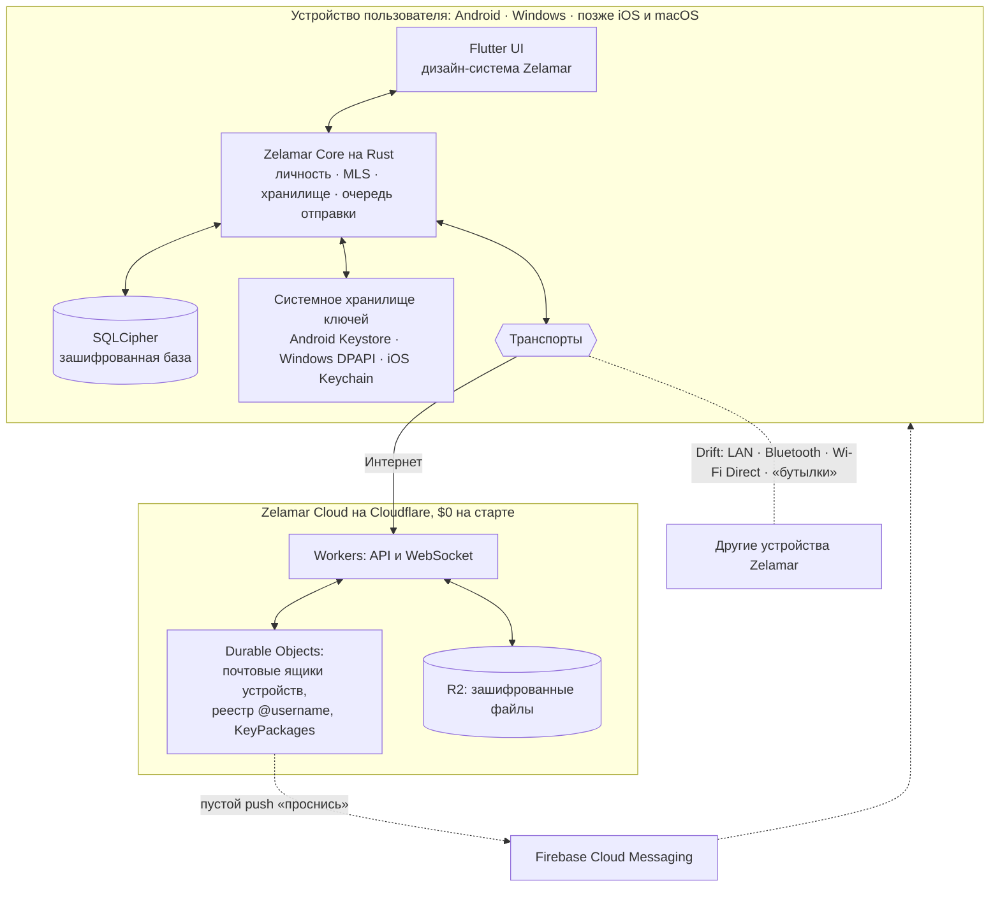
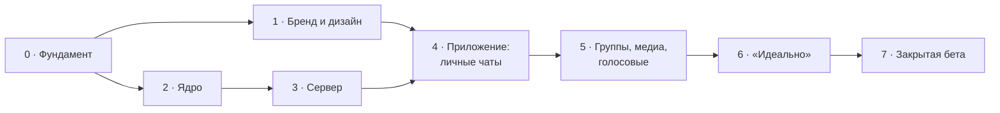

# Zelamar — Roadmap

> **Private by design. Beautiful by obsession.**
>
> Версия 1.0 · 13 октября 2026 · CEO — продукт, UX, дизайн · CTO (Claude) — архитектура, код, качество

Это живой документ. Он обновляется после каждого еженедельного демо. Здесь записано **что** и **в каком порядке** мы делаем. **Почему** принято каждое техническое решение, подробно описывается в `docs/adr/` (появится на этапе 0).

Язык: этот документ на русском, потому что его главный читатель — CEO. Код, комментарии и техническая документация пишутся на английском: продукт глобальный, и будущая команда тоже.

---

## 1. Видение

Zelamar — глобальный премиальный мессенджер с **максимальной приватностью без потери удобства**. Аккаунт создаётся за секунды: без телефона, без почты, только `@username`. Переписку не может прочитать никто, кроме собеседников, включая нас самих. Интерфейс должен стать любимым UX не только у нас.

Долгосрочная линия — **Drift**: Zelamar, который работает без интернета.

---

## 2. Принципы

Эти правила не меняются. Если решение противоречит принципу, неправо решение.

1. **Приватность обеспечивает архитектура, а не обещание.** Сервер технически не может прочитать сообщения и не знает, кто кому пишет. Мы не храним то, что можно не хранить.
2. **Сообщению всё равно, как его доставят.** Каждое сообщение — самодостаточный зашифрованный «конверт». Сегодня его несёт сервер, завтра Bluetooth или соседний телефон. Так Drift становится возможным без переписывания продукта.
3. **Никакой самодельной криптографии.** Только открытые стандарты и проверенные библиотеки.
4. **Перфекционизм обеспечивают инструменты, а не доверие.** CI не пропустит код с предупреждением линтера, без тестов или с непроверенной лицензией.
5. **Ворота качества вместо дедлайнов.** Этап закрыт, когда выполнены его критерии «идеально», а не когда наступила дата.
6. **$0 на инфраструктуру до появления реального продукта.** Только бесплатные тарифы. При этом архитектура переносима, без жёсткой привязки к поставщику.
7. **Криптография открыта, ноу-хау закрыто.** Всё, что касается безопасности, можно проверить. Наши уникальные решения (алгоритмы Drift, UX, серверная логика) остаются у нас.
8. **Дизайн решаем глазами.** CEO выбирает по живым прототипам, а не по описаниям.

---

## 3. Принятые решения

| # | Область | Решение | Почему |
|---|---|---|---|
| 1 | Название | **Zelamar** | Звучит премиально, пишется так, как слышится. `.com` / `.app` / `.chat` / GitHub / npm были свободны на 12.10.2026 |
| 2 | Позиционирование | Максимальная приватность + удобство + премиальность + очень низкий порог входа | Свободная ниша: приватные мессенджеры либо неудобные, либо некрасивые |
| 3 | Цель | Стартап | — |
| 4 | Первые пользователи | Друзья и знакомые | Быстрая и честная обратная связь |
| 5 | Регистрация | `@username`, без телефона и почты | Приватно, глобально, без расходов на SMS |
| 6 | Поиск людей | Точный `@username`, ссылка `zelamar.com/@nick`, QR-код. **Без** поиска по части ника | Никто не сможет перебрать базу пользователей |
| 7 | Незнакомцы | «Запросы на переписку»: до принятия не видны статусы, медиа заблокированы | Главная защита от спама при регистрации без телефона |
| 8 | Статусы | «В сети», «прочитано», «печатает» видят только контакты | Разумный баланс по умолчанию, меняется в настройках |
| 9 | Устройства | Аккаунт создаётся на **любом первом устройстве** (телефон или ПК), остальные привязываются по QR-коду или коду | Модель «только телефон» исключила бы людей без смартфона |
| 10 | Восстановление | По умолчанию passkey (где платформа поддерживает), по желанию фраза из 12 слов | «Изи» для большинства, полная независимость для параноиков |
| 11 | История | Хранится на устройстве, плюс зашифрованный бэкап с ключом только у пользователя | Честное E2EE без потери истории |
| 12 | Метаданные | Sealed sender: сервер не знает отправителя, не хранит списки контактов и состав групп | Защита социального графа |
| 13 | Открытость кода | Криптография и всё повторяемое открыто, ноу-хау закрыто | Доверие плюс защита от копирования |
| 14 | Протокол шифрования | **MLS** (IETF RFC 9420) через **OpenMLS** (лицензия MIT) | Signal Protocol (libsignal) под **AGPL-3.0** заставил бы открыть весь клиент |
| 15 | Стек | **Flutter** (интерфейс) + **Rust** (ядро) + **TypeScript** на **Cloudflare** (сервер) | См. раздел 4 |
| 16 | Платформы MVP | Android + Windows | iOS — когда появятся Mac и Apple Developer ($99 в год) |
| 17 | Функции MVP | Личные чаты, группы, фото и файлы, голосовые; ответы, реакции, редактирование | Минимум, без которого мессенджер не выглядит законченным |
| 18 | Язык интерфейса | Только английский (архитектура сразу готова к любым языкам, включая RTL) | Глобальный рынок |
| 19 | Дизайн и бренд | Направление выбираем глазами по прототипам, логотип создаём вместе | CEO — перфекционист в UX/UI |
| 20 | Монетизация | Пока не думаем, архитектура готова к подписке | Сначала продукт и любовь пользователей |
| 21 | Сроки | Без дедлайнов, ворота качества | Перфекционизм + структура |
| 22 | Юридическое | Без компании до публичного запуска. Перед запуском — анализ законов (CEO находится в Азербайджане) | Сейчас не нужно; при E2EE у нас нет ключей пользователей |
| 23 | Бюджет | $0 | Только бесплатные тарифы |
| 24 | Домен | Покупаем, когда появится продукт | Решение CEO, риск записан в разделе 9 |
| 25 | Процесс | Демо каждую неделю, roadmap в репозитории | Контроль CEO без микроменеджмента |
| 26 | Тестирование | CEO тестирует Windows-версию на ПК. Android проверяется автотестами в эмуляторе на серверах GitHub (скриншоты и видео прикладываются к демо) и другом-тестером на реальном телефоне. Эмулятор у CEO не ставим | У CEO нет смартфона. Flutter рисует UI одинаково, поэтому Windows-версия показывает почти весь UX |
| 27 | Офлайн | **Drift**: только софт, своего железа нет. Протокол готов к нему с первого дня | Стратегическое отличие от конкурентов |
| 28 | Визуальный язык | **Тёплая тихая роскошь, светлая тема главная**, тёмная тоже тёплая. Эталоны: Apple, Hermès / Loro Piana, Rolls-Royce / Bentley. Цвета: тёплые нейтральные, земляные, глубокие благородные, мягкие пастельные. **Никакого синего, голубого, чёрного и «киберпанка»** | Раунд 1 (Deep Sea, Pearl, Onyx, Tide) отклонён CEO 13.10.2026: «не премиально». В раунде 2 CEO выбрал **Ivory** 13.10.2026: слоновая кость, бронза, эспрессо; Cormorant Garamond + Geist. Правки по дизайну — по ходу разработки |
| 29 | Логотип | Эмблема **Sunset Z**: солнце садится за горизонт, отражение в воде складывается в букву Z. Монохромная, бронза на слоновой кости, шампань на эспрессо. Выбрана CEO 13.10.2026 | Предварительная проверка: среди мессенджеров похожих знаков нет, но мотив «солнце + волны» массово встречается в стоке, туризме и одежде. Поэтому нужен собственный поворот. Формальная проверка изобразительного товарного знака — до публичного запуска (этап 8) |
| 30 | Постквантовое шифрование | Шифронабор MLS **ML-KEM-768 + X25519** (гибридный, черновик IETF) с первого дня | Защита от атаки «собрать сейчас, расшифровать квантовым компьютером потом», как у iMessage PQ3 и Signal PQXDH (ADR-0009) |

---

## 4. Архитектура

### 4.1 Общая схема

### 4.2 Простыми словами

- **Ядро (Rust)** — мозг приложения. Здесь живут ключи, шифрование, база сообщений и очередь отправки. Одно ядро работает на всех платформах, поэтому безопасность реализована один раз, а не четыре.
- **Интерфейс (Flutter)** — лицо приложения. Flutter сам рисует каждый пиксель, поэтому Zelamar выглядит одинаково идеально на Android, Windows и позже на iOS.
- **Конверт** — единица передачи. Внутри лежит зашифрованное MLS-сообщение, снаружи — только непрозрачный адрес почтового ящика получателя. Кто отправитель, по конверту не видно.
- **Почтовый ящик** — у каждого устройства свой ящик на сервере. Сервер складывает туда конверты и отдаёт их, когда устройство выходит на связь. Прочитать их он не может.
- **Транспорты** — способы доставки конвертов. В MVP есть только «Интернет», но ядро с первого дня работает с абстракцией транспорта. Поэтому Drift будет добавлением нового транспорта, а не переделкой.

### 4.3 Ключевые технические понятия

- **Аккаунт и устройство.** У аккаунта есть долговременный ключ личности (подпись Ed25519). Каждое устройство — отдельный участник MLS со своими ключами, подписанными ключом аккаунта. Привязка нового устройства — это подпись его ключа уже доверенным устройством, по QR-коду или коду.
- **Чаты как MLS-группы.** Личный чат — группа из двух аккаунтов (то есть из всех их устройств). Групповой чат — то же самое, только участников больше. Один механизм для всего.
- **Forward secrecy и post-compromise security.** Ключи постоянно обновляются. Утечка сегодняшнего ключа не раскрывает ни прошлое, ни будущее после следующего обновления. В прототипе этого не было вообще.
- **KeyPackages.** Это заранее опубликованные одноразовые «приглашения» устройства. Они позволяют начать зашифрованный чат, даже когда собеседник офлайн.
- **Sealed sender.** Сервер принимает конверт по анонимному токену доставки, а не по личности отправителя.
- **Сверка ключей.** У каждой пары собеседников есть код безопасности (QR или слова). При смене ключа собеседника — заметное предупреждение. Никакой молчаливой подмены, как в прототипе.
- **Хранение на устройстве.** Используем SQLCipher: база зашифрована целиком, ключ лежит в системном хранилище ключей. В открытом виде на диске нет ни сообщений, ни их превью.

### 4.4 Стек

| Слой | Технология | Почему | Лицензия |
|---|---|---|---|
| Интерфейс | Flutter (Dart) | Попиксельно одинаковый премиальный UI, одна кодовая база для Android, Windows, iOS и macOS | BSD-3 |
| Ядро | Rust | Безопасность памяти, скорость, одно ядро для всех платформ и для Drift | MIT / Apache-2.0 |
| Мост UI ↔ ядро | flutter_rust_bridge v2 | Типобезопасная связка Dart и Rust | MIT |
| E2EE | OpenMLS (RFC 9420) | Современный стандарт IETF, группы и мультидевайс «из коробки» | MIT |
| Локальная БД | SQLite + SQLCipher | Шифрование базы целиком | BSD-style |
| Сервер | TypeScript (strict) на Cloudflare Workers + Durable Objects (SQLite) | $0 на старте, WebSocket с гибернацией, глобальная сеть | — |
| Файлы | Cloudflare R2 | 10 ГБ бесплатно, нет платы за исходящий трафик | — |
| Push (Android) | Firebase Cloud Messaging | Бесплатно. Шлём только пустое «проснись», без содержимого | — |
| CI | GitHub Actions | Ворота качества на каждое изменение | — |

**Отвергнуто:**
- libsignal — лицензия AGPL;
- Electron — тяжёлый, и прототип показал его слабые места;
- любая самодельная криптография.

### 4.5 Модель угроз (кратко, честно)

| Угроза | Защищены? |
|---|---|
| Сервер взломан или «подслушивает» | ✅ Не может прочитать сообщения, не знает отправителей |
| Наблюдатель в сети (провайдер, Wi-Fi) | ✅ Видит только зашифрованный трафик к Cloudflare |
| Подмена ключа собеседника | ✅ Сверка кодов безопасности, предупреждение при смене ключа |
| Утечка ключа устройства | ✅ Частично: forward secrecy и post-compromise security ограничивают ущерб |
| Украденный **разблокированный** телефон | ⚠️ Частично. Полностью закроют «PIN паники» и скрытые чаты (после MVP) |
| Вредоносная программа на устройстве | ❌ Вне модели угроз, это честно для любого мессенджера |
| Глобальный наблюдатель, анализирующий время сообщений | ⚠️ Частично. Полная защита (луковая маршрутизация) — за пределами MVP |

---

## 5. Этапы до закрытой беты

У каждого этапа есть цель, задачи, что нужно от CEO и **ворота качества** — критерии, без которых этап не закрывается. Объём указан как ориентир при ~15 часах в неделю. **Это не дедлайн.**

Этапы 1 и 2 идут **параллельно**: дизайн — это в основном работа CEO, ядро — работа CTO.

### Этап 0 — Фундамент
**Цель:** чистая основа, на которой невозможно писать грязный код.
**Ориентир:** 1–2 недели.

Что делаю я:
- Структура репозитория: `app/` (Flutter), `core/` (Rust), `server/` (TypeScript), `protocol/` (описание формата конвертов), `docs/`.
- Ворота качества в CI:
  - Rust: `rustfmt`, `clippy` в строгом режиме, где любое предупреждение — ошибка; `cargo-deny` (лицензии, уязвимости, запрет AGPL и GPL).
  - Dart: строгий анализатор, `dart format`.
  - TypeScript: `strict`, ESLint, Prettier.
  - Тесты на каждый коммит. Изменения в `main` попадают только через PR с зелёным CI. Бесплатный GitHub не умеет защищать ветки в приватных репозиториях, поэтому это правило держится на дисциплине и локальном хуке (ADR-0006).
- Первые ADR: стек, выбор MLS, транспортная абстракция, политика лицензий.
- «Hello, Zelamar»: Flutter-приложение вызывает функцию Rust-ядра на Windows и Android.
- Android-эмулятор в CI: автотесты на каждое изменение, скриншоты как артефакты сборки.

Что нужно от CEO:
- ✅ Организация `Zelamar` на GitHub создана (13.10.2026).

Ворота качества:
- [x] CI краснеет при любом предупреждении, ошибке форматирования, упавшем тесте или запрещённой лицензии (PR #1: 6 из 6 проверок зелёные).
- [x] CI собирает Windows- и Android-версии.
- [x] «Hello, Zelamar» проходит автотест в Android-эмуляторе CI (ядро на Rust работает на Android).
- [x] «Hello, Zelamar» запускается у CEO на Windows (подтверждено CEO 13.10.2026).
- [x] Написаны ADR-0001…0007.

### Этап 1 — Бренд и дизайн (параллельно с этапом 2)
**Цель:** визуальная идентичность Zelamar, которую CEO выбрал глазами.
**Ориентир:** 2–4 недели.

Что делаю я:
- 3–4 концепции логотипа (SVG).
- 3–4 визуальных направления в виде **интерактивных прототипов**, которые можно потрогать, а не картинок. Например: «Глубокое море», «Светлый минимализм», «Чёрная роскошь» и одно смелое направление.
- После выбора — дизайн-токены: цвета светлой и тёмной темы, типографика, сетка, скругления, **язык анимаций**.
- Ключевые экраны в выбранном стиле:
  - онбординг (≤ 30 секунд до первого сообщения);
  - список чатов;
  - чат;
  - запросы на переписку;
  - профиль и QR;
  - привязка устройства;
  - настройки приватности;
  - сверка ключей.

Что нужно от CEO:
- Выбрать направление и логотип, давать обратную связь, принять ключевые экраны.

Холст концепций (4 направления × 2 экрана + 4 логотипа): https://claude.ai/artifact/KYeMprYjytL7LukjTbcrpU

Ворота качества:
- [x] CEO утвердил логотип и визуальное направление: эмблема Sunset Z и направление Ivory (13.10.2026).
- [ ] ~~Ключевые экраны утверждены в светлой и тёмной темах.~~ По решению CEO экраны проектируются по ходу разработки каждой функции на этапе 4, правки вносятся сразу.
- [x] Контрастность соответствует WCAG AA: проверяется автотестом для обеих тем (`app/test/design_system_test.dart`).
- [x] Дизайн-токены зафиксированы в коде как единственный источник правды (ADR-0008).

### Этап 2 — Ядро Zelamar Core
**Цель:** безопасное сердце продукта, полностью покрытое тестами.
**Ориентир:** 4–6 недель.

Что делаю я:
- Личность: ключ аккаунта, ключи устройств, подпись привязки устройства.
- Интеграция OpenMLS:
  - чат как группа;
  - добавление и удаление участников;
  - мультидевайс;
  - обновление ключей.
- **Формат конверта** (спецификация в `protocol/`), с самого начала готовый к Drift.
- Модель сообщений: текст, ответы, реакции, редактирование, удаление, статусы доставки.
- Зашифрованное хранилище (SQLCipher), ключ в системном хранилище.
- Надёжная очередь отправки: сообщение, написанное без сети, **гарантированно** уйдёт после восстановления связи (в прототипе такие сообщения терялись).
- Время сообщений — всегда UTC в миллисекундах на стороне отправителя (в прототипе время «уезжало» на 4 часа).
- Код безопасности для сверки ключей.
- **Crypto Lab** — отладочный экран для еженедельных демо: два виртуальных пользователя переписываются через настоящее ядро, и видно, что именно шифруется.

Ворота качества:
- [ ] Каждая публичная функция ядра покрыта тестами, критические пути — property-based тестами.
- [ ] Парсер конвертов прошёл фаззинг без единого падения.
- [ ] `unsafe` нет нигде, кроме моста к Flutter. Ключи затираются в памяти после использования.
- [ ] Тест доказывает, что файл базы без ключа не читается.
- [ ] Модель угроз обновлена по фактической реализации.

### Этап 3 — Сервер (Delivery Service)
**Цель:** сервер, который доставляет всё и не знает ничего.
**Ориентир:** 3–4 недели.

Что делаю я:
- Реестр `@username`: регистрация, точный поиск, зарезервированные имена, защита от перебора.
- Каталог KeyPackages и устройств аккаунта.
- Почтовые ящики устройств (Durable Objects) и доставка в реальном времени по WebSocket с гибернацией.
- Sealed sender: анонимные токены доставки.
- Антиспам:
  - лимиты для новых аккаунтов;
  - лёгкое «доказательство работы» при регистрации (бесплатная защита от ботов без капчи);
  - запросы на переписку.
- Хранилище зашифрованных файлов (R2) с автоудалением через N дней, чтобы не выйти за бесплатную квоту.
- Пустые push-уведомления через FCM.

Что нужно от CEO:
- Создать бесплатные аккаунты Cloudflare и Firebase. Ресурсы компании должны принадлежать CEO.

Ворота качества:
- [ ] Тест-инспекция подтверждает: в данных сервера нет открытого текста, отправителей, списков контактов и состава групп.
- [ ] Нагрузочный прогон на уровне беты (50 пользователей × 200 сообщений в день) укладывается в бесплатные квоты с запасом ×3.
- [ ] Интеграционные тесты «ядро ↔ сервер» зелёные.
- [ ] Лимиты и антиспам проверены тестами.

### Этап 4 — Приложение: личные чаты
**Цель:** первый Zelamar, которым можно пользоваться каждый день.
**Ориентир:** 5–7 недель.

Что делаю я:
- Онбординг: выбор `@username`, создание ключей, предложение passkey или фразы восстановления.
- Список чатов, экран чата: отправка, ответы, реакции, редактирование, статусы, индикатор набора.
- Запросы на переписку, профиль, ссылка и QR, добавление контакта.
- Привязка второго устройства по QR-коду или коду (например, Windows и телефон друга).
- Настройки приватности, сверка ключей, предупреждение о смене ключа.
- Уведомления.
- Golden-тесты: эталонные скриншоты каждого экрана, CI ловит любое случайное изменение пикселей.

Что нужно от CEO:
- Еженедельная приёмка UX: тесты Windows-версии на ПК, просмотр Android-скриншотов и видео из CI, сессии с другом-тестером.

Ворота качества:
- [ ] От запуска до первого отправленного сообщения ≤ 30 секунд.
- [ ] Анимации без рывков (60 кадров/с) на Windows и на телефоне друга.
- [ ] Ни одного потерянного сообщения в тестах обрыва сети.
- [ ] Время сообщений корректно в любых часовых поясах.
- [ ] Golden-тесты всех экранов в обеих темах.
- [ ] CEO подписал приёмку UX.

### Этап 5 — Группы, медиа, голосовые
**Цель:** полный объём MVP.
**Ориентир:** 4–6 недель.

Что делаю я:
- Группы: создание, приглашение, выход, удаление участника, роли (администратор), до 100 участников в бете.
- Фото и файлы: шифрование на устройстве перед загрузкой, превью, прогресс; лимит размера в бете — до 25 МБ (из-за бесплатной квоты).
- Голосовые: запись, волна, воспроизведение, перемотка; кодек Opus.

Ворота качества:
- [ ] Сервер хранит файлы только в зашифрованном виде, ключи живут только внутри MLS-сообщений.
- [ ] Добавление и удаление участников корректно обновляет ключи (проверено тестами).
- [ ] UX групп и медиа принят CEO.

### Этап 6 — «Идеально» (полировка и защита)
**Цель:** довести продукт до состояния, за которое не стыдно ни снаружи, ни внутри.
**Ориентир:** 3–5 недель.

Что делаю я:
- Проход по производительности: холодный старт, прокрутка длинных чатов, память, размер приложения.
- Доступность: экранные дикторы, масштаб шрифта, контраст.
- Зашифрованный бэкап истории и восстановление (passkey или фраза), сквозной тест «потерял устройство — восстановился».
- Самоаудит безопасности по модели угроз, аудит зависимостей.
- Запрос внешнего ревью: проверим условия бесплатного аудита Red Team Lab от Open Technology Fund для открытых частей.
- Отчёты о сбоях только с согласия пользователя и без личных данных.
- Сборки для беты: Android APK для друга, установщик для Windows.

Ворота качества:
- [ ] Ноль известных падений, ноль известных багов уровня «потеря данных» или «утечка».
- [ ] Восстановление аккаунта и истории проверено сквозным тестом.
- [ ] Финальный проход CEO по всем экранам с вердиктом «идеально».

### Этап 7 — Закрытая бета
**Цель:** друзья пользуются Zelamar каждый день.

- Приглашаем друзей по приглашениям: это ощущение премиальности плюс контроль нагрузки.
- Канал обратной связи без слежки, то есть без аналитики поведения. Только явные отзывы.
- Еженедельные исправления.

Ворота перехода к публичному запуску:
- [ ] Минимум 2 недели ежедневного использования у ядра бета-группы.
- [ ] Все критичные замечания закрыты.

### Этап 8 — Подготовка к публичному запуску
- Купить `zelamar.com` (и `.app`, `.chat`), если ещё не куплены.
- Юрисдикция и компания: анализ законов Азербайджана о мессенджерах, выбор страны для компании и серверов, регистрация товарного знака: словесного «Zelamar» и изобразительного (логотип), с профессиональным поиском похожих знаков.
- Политика конфиденциальности и условия использования.
- Публикация в Google Play (разовый взнос $25).
- Сайт `zelamar.com` и страница `zelamar.com/@nick`.
- iOS и macOS (при появлении Mac или облачной сборки и $99 в год).

---

## 6. После MVP: линии развития

### 6.1 Вау-функции
| Функция | Суть | Ограничения платформ |
|---|---|---|
| **Скрытые чаты + PIN паники** | Второй PIN открывает «чистый» профиль, если тебя заставляют разблокировать приложение | — |
| **Исчезающие сообщения** | Таймер для чата или отдельного сообщения | Получатель всегда может сфотографировать экран, об этом скажем честно |
| **Защита от скриншотов** | Запрет снимков экрана в выбранных чатах | Android — полноценно (`FLAG_SECURE`). Windows — исключение окна из захвата. iOS — только обнаружение и обходные приёмы |

### 6.2 Drift — Zelamar без интернета

Метафора из имени: *mar* — «море». Сообщение без сети уходит как **бутылка в море**.

| Ступень | Что | Где |
|---|---|---|
| D0 | Архитектурная готовность: конверты, транспортная абстракция, псевдонимные адреса | **Уже в MVP** |
| D1 | **Локальная сеть**: общий Wi-Fi-роутер без интернета (офис, кампус, лайнер) | Windows, Android |
| D2 | **Рядом**: прямое соединение по Bluetooth LE, Wi-Fi Direct или Wi-Fi Aware | Сначала Android, потом Windows |
| D3 | **«Бутылки»**: конверт несут телефоны других пользователей Zelamar, пока не встретят адресата или интернет. Носители ничего не могут прочитать | Android |
| D4 | **Креативные транспорты**: R&D-список нестандартных идей, например анимированный QR между двумя экранами или передача данных звуком | Исследуем |

Честно о трудностях:
- iOS сильно ограничивает Bluetooth в фоне, поэтому Drift начинается на Android.
- Mesh-режим расходует батарею.
- Изменения состава групп (MLS commits) требуют упорядочивания, поэтому в Drift в первую очередь работают обычные сообщения внутри уже существующих чатов.
- Позиционирование — не «первый в мире офлайн-мессенджер» (такие есть: Briar, Bridgefy, Berty), а **первый премиальный мессенджер для всех, где офлайн просто работает**.

### 6.3 Остальное
- **iOS и macOS.**
- **Звонки** (аудио и видео, WebRTC + E2EE). Нужны TURN-серверы, а это первые реальные расходы.
- **Key transparency**: публичный журнал ключей, чтобы даже сервер не мог незаметно подменить ключ.
- **Постквантовая защита**: проверим зрелость постквантовых наборов шифров в OpenMLS и заложим путь обновления.
- **Zelamar Premium** — когда придёт время, приватная проверка подписки без привязки к личности.
- **Другие языки интерфейса**, включая RTL.
- **Гранты**: NLnet (NGI Zero) и Open Technology Fund для открытых частей. Проверим условия, они часто требуют открытости финансируемого кода.

---

## 7. Как мы работаем

**Роли.**
- CEO: видение, продукт, UX, дизайн, приёмка, люди и тестеры.
- CTO (Claude): архитектура, весь код, качество, безопасность, инфраструктура, объяснение технических решений на языке продукта.

**Еженедельное демо:**
1. Что сделано — коротко и по делу.
2. Живая сборка или интерактивный прототип: смотришь и трогаешь сам.
3. Решения, которые нужны от CEO.
4. План на следующую неделю.

**Где живут знания (чтобы ничего не терялось между сессиями):**
- `ROADMAP.md` — что делаем и статус (этот файл).
- `docs/adr/` — почему принято каждое важное решение.
- `docs/architecture/` и `protocol/` — как всё устроено.
- Git-история и PR — что и когда изменилось.

**Правила кода:**
- Каждое изменение `main` — PR, который сливается только с зелёным CI. Это жёсткое правило, а не настройка GitHub (ADR-0006).
- Осмысленные сообщения коммитов (Conventional Commits).
- Ни одной зависимости без проверки лицензии и безопасности.

---

## 8. Статус

| Этап | Статус |
|---|---|
| Бриф и решения (разделы 1–3) | ✅ Готово |
| 0 · Фундамент | ✅ Готово |
| 1 · Бренд и дизайн | ✅ Готово: Ivory + Sunset Z в коде, иконки, WCAG AA |
| 2 · Ядро | 🔄 В работе: срез 1 (MLS + постквант, сертификаты) и срез 2 (зашифрованное хранилище, атомарные операции) готовы, 39 тестов |
| 3 · Сервер | ⏳ Ожидает |
| 4 · Приложение: личные чаты | ⏳ Ожидает |
| 5 · Группы, медиа, голосовые | ⏳ Ожидает |
| 6 · «Идеально» | ⏳ Ожидает |
| 7 · Закрытая бета | ⏳ Ожидает |
| 8 · Публичный запуск | ⏳ Ожидает |

---

## 9. Риски

| Риск | Вероятность | Влияние | Что делаем |
|---|---|---|---|
| Перфекционизм без дедлайнов растягивает проект на годы | Высокая | Высокое | Ворота качества, еженедельные демо, **заморозка объёма MVP**: новые идеи идут в раздел 6, а не в текущий этап |
| Кто-то зарегистрирует `zelamar.com` до нас | Низкая | Высокое | Риск принят CEO. Правило: купить домен **до первого публичного упоминания** имени |
| Ошибки в криптографии | Средняя | Критичное | Только стандарт MLS и проверенные библиотеки, тесты, фаззинг, внешнее ревью до публичного запуска |
| Спам-боты (регистрация без телефона) | Высокая | Среднее | Запросы на переписку, лимиты, «доказательство работы» при регистрации |
| Выход за бесплатные квоты | Низкая (в бете) | Среднее | Мониторинг квот, автоудаление файлов, переносимая архитектура |
| У CEO нет телефона, мало тестов на реальных устройствах | Средняя | Среднее | Android-эмулятор в CI со скриншотами и видео, друг-тестер. По возможности — недорогой б/у Android для тестов |
| Юридические требования к мессенджерам | Средняя | Высокое | Анализ законов и выбор юрисдикции до публичного запуска |
| Потеря контекста между сессиями разработки | Средняя | Среднее | ADR, этот roadmap, архитектурные документы, дисциплина PR |
| Потеря кода (как старого сервера) | Низкая | Критичное | Всё в git + приватный репозиторий на GitHub с первого дня |

---

## 10. Открытые вопросы (решим по ходу)

- Визуальное направление и логотип — этап 1.
- Креативные транспорты Drift (D4) — R&D после MVP.
- Модель монетизации — после беты.
- Страна компании и серверов — этап 8.
- Резервное хранилище зашифрованных бэкапов: наш R2 или облако пользователя — этап 6.
